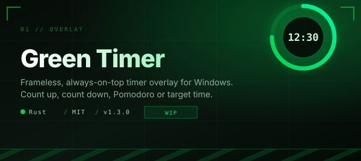
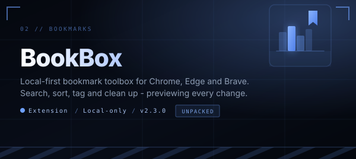
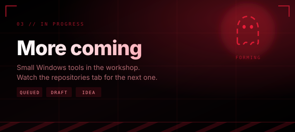

<picture>
  <source media="(prefers-color-scheme: light)" srcset="docs/assets/banner-light.svg">
  <source media="(prefers-color-scheme: dark)" srcset="docs/assets/banner-dark.svg">
  
</picture>

 

---

I make the kind of utility I keep wishing already existed: a timer that sits over
a game, an installer that doesn't want your admin password, a tray app that
doesn't quietly phone home. When something annoys me enough, it becomes a repo.

---

## Repositories

> [!WARNING]
> Green Timer is a work in progress and ships as pre-releases. The UI and file
> formats may still change between versions.

> [!NOTE]
> BookBox isn't on the Chrome Web Store yet. It loads unpacked from source in
> Chrome, Edge and Brave — [install steps](https://lvspook.github.io/BookBox/#install)
> take about a minute.

---

## Stack

---

## The numbers

<picture>
  <source media="(prefers-color-scheme: light)" srcset="https://github-readme-stats.vercel.app/api?username=LvSpook&show_icons=true&hide_title=true&hide_border=true&bg_color=ffffff&title_color=c1121f&icon_color=c1121f&text_color=2a1013&rank_icon=github">
  <source media="(prefers-color-scheme: dark)" srcset="https://github-readme-stats.vercel.app/api?username=LvSpook&show_icons=true&hide_title=true&hide_border=true&bg_color=000000&title_color=ff1f3d&icon_color=ff1f3d&text_color=f5d7da&rank_icon=github">
  
</picture>

<picture>
  <source media="(prefers-color-scheme: light)" srcset="https://github-readme-stats.vercel.app/api/top-langs/?username=LvSpook&layout=compact&hide_border=true&bg_color=ffffff&title_color=c1121f&text_color=2a1013&langs_count=6">
  <source media="(prefers-color-scheme: dark)" srcset="https://github-readme-stats.vercel.app/api/top-langs/?username=LvSpook&layout=compact&hide_border=true&bg_color=000000&title_color=ff1f3d&text_color=f5d7da&langs_count=6">
  
</picture>

  

<picture>
  <source media="(prefers-color-scheme: light)" srcset="https://streak-stats.demolab.com?user=LvSpook&hide_border=true&background=ffffff&stroke=f3dcdf&ring=c1121f&fire=e11d2e&currStreakNum=a11322&sideNums=0a0a0b&currStreakLabel=c1121f&sideLabels=8c5a60&dates=8c5a60">
  <source media="(prefers-color-scheme: dark)" srcset="https://streak-stats.demolab.com?user=LvSpook&hide_border=true&background=000000&stroke=2a0a0f&ring=ff1f3d&fire=ff5c74&currStreakNum=ff5c74&sideNums=f5d7da&currStreakLabel=ff1f3d&sideLabels=b06870&dates=b06870">
  
</picture>

  

<picture>
  <source media="(prefers-color-scheme: light)" srcset="https://github-readme-activity-graph.vercel.app/graph?username=LvSpook&bg_color=ffffff&color=2a1013&line=c1121f&point=a11322&area=true&area_color=c1121f&hide_border=true">
  <source media="(prefers-color-scheme: dark)" srcset="https://github-readme-activity-graph.vercel.app/graph?username=LvSpook&bg_color=000000&color=f5d7da&line=ff1f3d&point=ff5c74&area=true&area_color=ff1f3d&hide_border=true">
  
</picture>

---

## How this is built

Some of my code, docs and release tooling are written with the help of an AI
coding assistant, under my direction and review. I say so because you should
know how the software you install was made. It is not an official product of any
AI company and is not endorsed by one. AI-assisted code can contain mistakes a
human would not have made — tests and manual checks reduce that risk but cannot
remove it.

---

[**lvspook.github.io**](https://lvspook.github.io/LvSpook/) · [**Repositories**](https://github.com/LvSpook?tab=repositories)

Windows · Rust · MIT · built in small pieces

